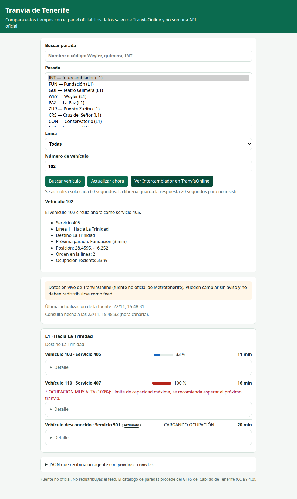

<p align="center">
  
</p>

<p align="center">
  <a href="https://github.com/Yannedugo/metrotenerife-mcp/actions/workflows/ci.yml"></a>
  <a href="LICENSE"></a>
  <a href="https://www.python.org/"></a>
  <a href="https://hacs.xyz/"></a>
</p>

Consulta los próximos tranvías de Tenerife desde un agente de IA (servidor [MCP](https://modelcontextprotocol.io)) o desde Home Assistant. También hay una página local, `metrotenerife-demo`, para mirar los tiempos en el navegador.

El mismo código lee TranvíaOnline para los tres. Está preparado para añadir más adelante otro operador —las guaguas de TITSA— sin reescribir los modelos.

> **Proyecto personal, no oficial y sin ánimo de lucro.** No está afiliado, patrocinado ni avalado por Metropolitano de Tenerife, S.A. ni por el Cabildo Insular de Tenerife. Las marcas son de sus titulares. Los tiempos en vivo salen de la web pública TranvíaOnline, sin garantía, y no se almacenan ni se redistribuyen. El catálogo de paradas deriva de un GTFS con licencia CC BY 4.0. No lo uses para una decisión crítica. El detalle y la atribución están en [NOTICE.md](NOTICE.md). Si un titular pide retirarlo, se retira o se adapta: el contacto son los [issues](https://github.com/Yannedugo/metrotenerife-mcp/issues).

## Qué se ve

La demo local agrupa los dos tranvías que anuncia el panel y, cuando se puede calcular con prudencia, un tercero marcado como **estimado**. La ocupación usa la misma tabla que la web: el número crudo no es un porcentaje.

<p align="center">
  
</p>

La captura es la página local con una respuesta de muestra: el vehículo 102, dos tranvías anunciados (uno con ocupación muy alta) y un tercero estimado. En tu máquina los minutos, el vehículo y la ocupación son los del momento.

## Probarlo en local

Hace falta Python 3.11 o superior. No hace falta Home Assistant ni un servidor MCP.

**Windows** (PowerShell, en la carpeta del repositorio):

```powershell
py -3.12 -m venv .venv
.\.venv\Scripts\python -m pip install -e .
.\.venv\Scripts\metrotenerife-demo
```

**macOS y Linux:**

```bash
python3 -m venv .venv
.venv/bin/python -m pip install -e .
.venv/bin/metrotenerife-demo
```

Abre [http://127.0.0.1:8000](http://127.0.0.1:8000). Si el puerto está ocupado, `--port 8001`. Si no conecta, `--debug` escribe en la terminal el tipo de error y el mensaje.

En macOS, un Python instalado desde python.org a veces no trae los certificados del sistema. Este programa usa el paquete `certifi` y no desactiva la verificación. Si aun así falla, ejecuta `Install Certificates.command` dentro de la carpeta de tu Python.

## Un agente, con MCP

```bash
pip install -e ".[mcp]"
```

stdio, para Claude Desktop o Cursor. Claude: Ajustes, Desarrollador, Editar configuración. Cursor: Ajustes, MCP.

```json
{
  "mcpServers": {
    "metrotenerife": {
      "command": "/ruta/absoluta/al/entorno/bin/metrotenerife-mcp",
      "args": []
    }
  }
}
```

En Windows la ruta acaba en `.venv\\Scripts\\metrotenerife-mcp.exe`.

HTTP streamable, en `http://127.0.0.1:8080/mcp`:

```bash
metrotenerife-mcp --transport http --host 127.0.0.1 --port 8080
```

`GET /health` responde `{"status": "ok"}`.

Preguntas que el agente puede resolver con las herramientas:

- «¿Cuándo llega el próximo tranvía a La Trinidad?»
- «En Intercambiador, ¿qué hay de la línea 1 hacia La Trinidad y de la línea 2 hacia La Cuesta?»
- «¿Va muy lleno el próximo tranvía en Weyler?»
- «¿Dónde está el vehículo 102?»
- «¿Cuándo pasa un tranvía por Gracia hacia La Trinidad mañana a las 7:50?»
- «¿Qué paradas coinciden con “cruz”?»

| Herramienta | Qué devuelve |
| --- | --- |
| `buscar_parada` | Paradas del catálogo cuyo nombre o código coincide. |
| `proximos_tranvias` | Por cada sentido, hasta 3 llegadas. Las dos primeras salen del panel; la tercera, si aparece, va marcada `estimado: true`. Cada llegada trae el servicio y, si la fila es reciente, el número de vehículo pintado en la unidad. Si ese servicio está en la posición en vivo, también trae coordenadas, próxima parada y `orderStop`. `por_sentido` admite de 1 a 6. |
| `estado_tranvias` | Posición de los vehículos, próxima parada, orden en la línea y ocupación, si el dato es reciente. El número de vehículo queda vacío cuando la fila es vieja. |
| `info_vehiculo` | Consulta por el número pintado. Devuelve servicio, línea, sentido, destino, coordenadas, próxima parada, minutos y ocupación. Si no circula o la fila es antigua, lo dice y no rellena el estado. |
| `info_lineas` | Líneas, sentidos y paradas en orden de marcha. |
| `prevision_tranvias` | Pasos teóricos por una parada y un sentido entre dos horas. Cada paso es `previsto`, y si la consulta cae en la próxima media hora también puede ser `en_vivo` o `estimado`. No es el horario oficial. |

## Previsión

La tabla de frecuencias de 2026 está en `src/metrotenerife/data/frecuencias_2026.json`. Sale de la página pública [Recorridos y horarios](https://metrotenerife.com/recorridos-y-horarios/), leída el 22 de noviembre de 2026. El tiempo hasta la parada se suma con los minutos entre paradas del catálogo.

Es una aproximación. Cada franja reparte salidas uniformes desde su hora de inicio; no copia el PDF de paso por parada. Las temporadas siguen el párrafo de esa página etiquetado 2026, que no coincide del todo con las fechas de la cabecera de la tabla. Los festivos locales, como el Carnaval, no están en la lista. No lo uses como horario en el que fiarte.

En la demo, «Próximas horas» enseña las tres horas siguientes de la parada elegida. En Home Assistant, el sensor del próximo tranvía lleva un atributo `forecast` con hasta ocho pasos.

## Home Assistant

La integración es custom. El botón de abajo abre el asistente de HACS para añadir este repositorio. Sin HACS, copia `custom_components/metrotenerife` (incluida la carpeta `vendor`) en `config/custom_components/` y reinicia.

[](https://my.home-assistant.io/redirect/hacs_repository/?owner=Yannedugo&repository=metrotenerife-mcp&category=integration)

Después: Ajustes, Dispositivos y servicios, Añadir integración, «Tranvía de Tenerife».

[](https://my.home-assistant.io/redirect/config_flow_start/?domain=metrotenerife)

Una sola entrada de configuración, con el intervalo de sondeo (mínimo 60 segundos, por defecto 90). Cada parada es una subentrada: se busca por nombre y se puede limitar a una línea y un sentido.

| Sensor | Valor |
| --- | --- |
| Próximo tranvía | Hora del primero. Atributos: minutos, destino, línea, servicio, número de vehículo, ocupación, posición si existe, y `forecast` con pasos previstos. |
| Segundo tranvía | La otra llegada que anuncia el panel para ese mismo sentido. |
| Tercer tranvía | Solo si hay una estimación fiable. Si no, queda en desconocido. El atributo `origin` vale `estimado`. |
| Minutos | Minutos hasta el primero. |
| Por línea | Si no filtraste la línea, un sensor por cada línea que pasa por la parada. |

La ocupación desconocida no se inventa: hace falta un dato reciente de `cargaVehiculo`. El número de vehículo sale de esa misma fila (`VEHICULO`), unida por servicio, y solo si la fecha es reciente. La web oficial lo enseña en el mapa, no en el panel de la parada. A partir de un valor crudo de 80 la web muestra ocupación muy alta; aquí se replica esa tabla y ese aviso.

## Preguntas frecuentes

**¿Es oficial?** No. Es un proyecto personal. La fuente en vivo es la web pública TranvíaOnline, que puede cambiar o dejar de responder sin aviso.

**¿Por qué a veces no hay ocupación, o el vehículo sale como desconocido?** Porque no llegó una fila reciente para ese servicio, o porque la fila era vieja. La ocupación se muestra como «CARGANDO OCUPACIÓN», igual que la web cuando aún no tiene el dato. El número pintado tampoco se rellena con esa fila vieja.

**¿Servicio y vehículo son lo mismo?** No. El servicio identifica la marcha. El vehículo es el número pintado en el tranvía. En la demo se leen los dos: «Vehículo 102 · Servicio 405». El detalle plegable añade la próxima parada, las coordenadas y el orden, cuando la posición en vivo trae ese servicio. El buscador «Buscar vehículo» y la herramienta `info_vehiculo` consultan por ese número.

**¿Por qué el tercero dice «estimado»?** El panel devuelve dos llegadas por parada, línea y sentido. La tercera se calcula con la posición de un vehículo que aún no ha sido anunciado y con los minutos entre paradas del catálogo. Si el vehículo ya pasó, si tendría que dar la vuelta en la cabecera o si el cálculo no es posterior a los dos anunciados, no se muestra.

**¿Puedo fiarme para salir de casa con el tiempo justo?** No. Contrasta con el panel oficial si la hora importa.

**En el Mac dice que no se pudo verificar el certificado.** El mensaje incluye el tipo de excepción. `--debug` deja el trazado en la terminal. La comprobación TLS no se desactiva.

## Roadmap

El registro de operadores ya separa «quién opera» de «cómo se lee». El siguiente operador previsto es TITSA, las guaguas, con su propia fuente y el mismo contrato hacia el MCP y Home Assistant. Hasta entonces solo está el tranvía.

## Contribuir

Las incidencias y las propuestas van a los [issues](https://github.com/Yannedugo/metrotenerife-mcp/issues). Antes de un cambio:

```bash
python3 -m ruff check src tests custom_components scripts
python3 -m ruff format --check src tests custom_components scripts
python3 scripts/sync_vendor.py --check
python3 -m pytest -q
```

Los tests no llaman a TranvíaOnline: usan respuestas grabadas. Si tocas `src/metrotenerife`, ejecuta `python3 scripts/sync_vendor.py` para copiar la librería dentro de la integración; la copia es un subpaquete de la integración y el script convierte sus importaciones en relativas. No subas un volcado histórico del feed en vivo.

## Licencia

El código está bajo [MIT](LICENSE), copyright 2026 Yann Favier (Yannedugo). Esa licencia cubre el código, no los datos de terceros. La atribución del GTFS y el aviso sobre el uso de TranvíaOnline están en [NOTICE.md](NOTICE.md).
