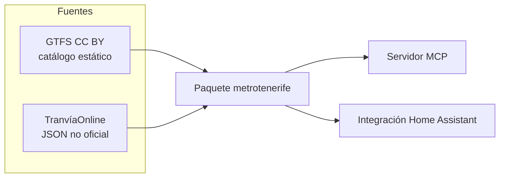

# Tranvía de Tenerife

Tiempos en vivo del tranvía de Tenerife (Metrotenerife) para agentes de IA, con un servidor [MCP](https://modelcontextprotocol.io), y para Home Assistant, con una integración instalable con HACS.

El mismo código que habla con TranvíaOnline sirve a los dos. Está pensado para poder añadir otro operador —TITSA, las guaguas— sin reescribir el servidor ni los modelos.

[](https://github.com/Yannedugo/metrotenerife-mcp/actions/workflows/ci.yml)
[](LICENSE)

> **No es un servicio oficial.** Este proyecto no está afiliado, patrocinado ni mantenido por Metropolitano de Tenerife ni por el Cabildo Insular de Tenerife. TranvíaOnline no es una API pública: no tiene contrato, puede cambiar sin aviso y no hay que tratarla como un feed para redistribuir. El sondeo es deliberadamente lento.

## Atribución de los datos

El catálogo de paradas, coordenadas, líneas y orden de marcha es un derivado del GTFS de **Metropolitano de Tenerife**, publicado por el **Cabildo Insular de Tenerife** en [datos.tenerife.es](https://datos.tenerife.es/ckan/dataset/4b83e018-37d9-40a6-b6d1-1df2b91c8117) y en [metrotenerife.com/transit/google_transit.zip](https://metrotenerife.com/transit/google_transit.zip), bajo licencia [Creative Commons Attribution 4.0 (CC BY 4.0)](https://creativecommons.org/licenses/by/4.0/).

Ese feed tiene vigencia **2024-09-08 a 2025-07-15** y está caducado. Aquí solo se usa como catálogo: no se copian frecuencias ni horarios. Algunas tildes que el CSV perdía («Señor», «España», «Jerónimo») están restituidas. La atribución viaja dentro de `catalog.json`, que es lo que se instala.

Los tiempos en vivo se consultan en el momento, desde tu máquina, a `tranviaonline.metrotenerife.com`. No se republican.

## Qué hay en el repositorio



| Pieza | Para qué |
| --- | --- |
| `src/metrotenerife` | Librería asyncio. Catálogo, cliente HTTP, modelos y registro de operadores. |
| `src/metrotenerife_mcp` | Servidor MCP. stdio para usarlo en local y HTTP streamable para alojarlo. |
| `src/metrotenerife_demo` | Página local para contrastar los tiempos con TranvíaOnline. |
| `custom_components/metrotenerife` | Integración de Home Assistant. La librería va vendorizada en `vendor/`. |

## Probarlo en local

La página usa la misma librería que el servidor MCP. Sirve para mirar los minutos al lado del panel oficial de TranvíaOnline.

Hace falta Python 3.11 o más nuevo. No hace falta saber qué es un entorno virtual: el comando crea una carpeta `.venv` con su propia copia de Python, sin tocar el resto del ordenador. Abre una terminal en la carpeta del proyecto (en Windows, la carpeta donde está este README).

### Windows

1. Comprueba Python. En PowerShell o en el Símbolo del sistema: `py --version`. Si no reconoce `py`, prueba `python --version`. Tiene que decir 3.11 o más.
2. Crea la carpeta del entorno: `py -m venv .venv` (o `python -m venv .venv`).
3. Instala el proyecto: `.venv\Scripts\python -m pip install -e .`
4. Arranca la página: `.venv\Scripts\metrotenerife-demo`
5. Abre el navegador en [http://127.0.0.1:8000](http://127.0.0.1:8000).

### macOS

1. Abre Terminal, entra en la carpeta del proyecto y comprueba Python: `python3 --version`. Tiene que decir 3.11 o más.
2. Crea la carpeta del entorno: `python3 -m venv .venv`
3. Instala el proyecto: `.venv/bin/python -m pip install -e .`
4. Arranca la página: `.venv/bin/metrotenerife-demo`
5. Abre el navegador en [http://127.0.0.1:8000](http://127.0.0.1:8000).

### Linux

Los mismos pasos que en macOS:

```bash
python3 --version
python3 -m venv .venv
.venv/bin/python -m pip install -e .
.venv/bin/metrotenerife-demo
```

Luego abre [http://127.0.0.1:8000](http://127.0.0.1:8000).

Elige una parada, o escribe parte del nombre. Cada tranvía muestra los minutos y, si el dato es reciente, el porcentaje de ocupación. La lista se refresca sola cada 60 segundos y también con **Actualizar ahora**. El enlace **Ver en TranvíaOnline** abre el panel oficial de esa parada para comparar. Al final de la página está el JSON que devolvería la herramienta `proximos_tranvias` a un agente. Para cerrar el programa, vuelve a la terminal y pulsa Ctrl+C. Si no conecta, vuelve a lanzarlo con `--debug` (en Windows, `.venv\Scripts\metrotenerife-demo --debug`) y mira el mensaje: incluye la causa, por ejemplo un fallo de certificado.

Si el puerto 8000 está ocupado: `metrotenerife-demo --port 8001` y abre `http://127.0.0.1:8001`. En Windows el comando es `.venv\Scripts\metrotenerife-demo --port 8001`.

## Librería

El cliente usa `aiohttp`, con tipos, tiempos de espera, caché de 20 segundos y como mucho una petición a la vez, separadas al menos un segundo. Ante un 429 o un 5xx reintenta dos veces, con espera creciente y respetando `Retry-After` (como máximo 30 segundos). El `User-Agent` identifica el proyecto y dice que el uso es personal.

La ocupación (`/api/cargaVehiculo`, campo `CARGA`) se une por el número de servicio. En el JavaScript oficial, `CARGA` no es un porcentaje: `getCargaNormalizada` lo convierte a uno (por ejemplo 28 se muestra como 33 %). Si el valor crudo es 80 o más, el texto es el aviso de ocupación muy alta y el indicador pasa a rojo; por debajo, azul y «OCUPACIÓN: N %». Sin fila reciente se muestra como desconocida, igual que el «CARGANDO OCUPACIÓN» de la web. La API anuncia dos llegadas por parada, línea y sentido. Un tercero, si aparece, está marcado `estimado` y sale de la posición del siguiente tranvía más los minutos entre paradas del GTFS caducado. Si haría falta dar la vuelta en la cabecera, no se muestra.

Las peticiones verifican el certificado TLS con el almacén de `certifi`. Así funciona también el Python de python.org en macOS, que no trae raíces hasta ejecutar Install Certificates.command. La verificación no se desactiva. Si aun así falla, el mensaje incluye el tipo de excepción y un texto breve; `metrotenerife-demo --debug` escribe el detalle en la terminal.

La búsqueda de paradas no distingue tildes ni mayúsculas: `guimera`, `GUIMERÁ` y `03` encuentran Teatro Guimerá.

```python
from metrotenerife import TranviaOnlineClient, TranviaOperator

async with TranviaOnlineClient() as client:
    operator = TranviaOperator(client)
    parada, llegadas, cuando = await operator.arrivals("Weyler", line=1)
```

### Por qué la librería va vendorizada y no en PyPI

Home Assistant, al instalar una integración de HACS, solo copia `custom_components/metrotenerife`. No instala el resto del repositorio. Un `requirements` del manifest solo funciona si el paquete está publicado.

El repositorio es privado todavía, así que publicarlo en PyPI ahora dejaría la integración a medias. La copia canónica está en `src/metrotenerife`. `scripts/sync_vendor.py` la vuelca en `custom_components/metrotenerife/vendor/metrotenerife`, y la integración la importa desde ahí. La integración y el servidor MCP ejecutan el mismo código. El workflow falla si las dos copias se separan.

Cuando el repo sea público se puede publicar `metrotenerife` en PyPI, poner esa dependencia en el manifest y borrar `vendor/`. Hasta entonces, la copia vendorizada es la que hace que HACS funcione sin un paso extra.

### Añadir otro operador

Los modelos (`Stop`, `Arrival`, `Vehicle`, `Line`) no son del tranvía. Un operador nuevo implementa el protocolo `TransitOperator` —buscar paradas, líneas, llegadas y vehículos— y se registra:

```python
registry = OperatorRegistry()
registry.register(TranviaOperator(client))
registry.register(TitsaOperator(...))  # todavía no existe
```

Las herramientas MCP ya aceptan `operador`. Hoy el único valor es `tranvia`; cualquier otro nombre devuelve la lista de operadores registrados. TITSA no está implementada: no hay un cliente a medias que parezca que funciona.

## Servidor MCP

El SDK oficial de Python, versión 2, llama `MCPServer` a lo que en la 1.x se llamaba FastMCP. Este servidor usa esa clase. No hace falta elegir la versión vieja.

Herramientas:

| Herramienta | Qué devuelve |
| --- | --- |
| `buscar_parada` | Paradas del catálogo que encajan con el texto. |
| `proximos_tranvias` | Próximos tranvías de una parada. Filtros opcionales: `linea` (1 o 2), `sentido` (1 o 2) y `destino`. |
| `estado_tranvias` | Posición de las unidades y ocupación, si el dato es reciente. |
| `info_lineas` | Líneas, sentidos y paradas en orden. Es catálogo, no un horario. |

Las respuestas de tiempos en vivo incluyen `obtenido_a` (cuándo consultamos), `actualizacion_fuente` (la marca de tiempo del panel, si la hay) y un aviso de que son datos en vivo de una fuente no oficial. Si el nombre encaja con varias paradas, la respuesta trae los candidatos en vez de adivinar.

Sentidos habituales, que en las terminales a veces no cuadran con el panel:

| Línea | Sentido 1 | Sentido 2 |
| --- | --- | --- |
| 1 | Hacia La Trinidad | Hacia Intercambiador |
| 2 | Hacia La Cuesta | Hacia Tíncer |

### Arrancar el servidor para un agente

Con el entorno del apartado [Probarlo en local](#probarlo-en-local) ya creado, instala también el extra del MCP y arranca el servidor.

macOS y Linux:

```bash
.venv/bin/python -m pip install -e ".[mcp]"
.venv/bin/metrotenerife-mcp
```

Windows:

```bat
.venv\Scripts\python -m pip install -e ".[mcp]"
.venv\Scripts\metrotenerife-mcp
```

Eso habla por la entrada y salida estándar y no imprime nada: es lo que espera un cliente MCP.

Claude Desktop, en `claude_desktop_config.json`:

```json
{
  "mcpServers": {
    "metrotenerife": {
      "command": "/ruta/absoluta/al/.venv/bin/metrotenerife-mcp"
    }
  }
}
```

Cursor, en `.cursor/mcp.json` del proyecto o en la configuración global de MCP:

```json
{
  "mcpServers": {
    "metrotenerife": {
      "command": "/ruta/absoluta/al/.venv/bin/metrotenerife-mcp"
    }
  }
}
```

Usa la ruta absoluta del ejecutable del entorno virtual. Si el comando no está en el `PATH` del cliente, un simple `metrotenerife-mcp` no lo encuentra.

### HTTP streamable, para alojarlo después

```bash
metrotenerife-mcp --transport http --host 127.0.0.1 --port 8080
```

El punto MCP queda en `http://127.0.0.1:8080/mcp`. Un cliente que hable HTTP streamable lo configura con esa URL. `GET /health` responde `{"status": "ok"}` y no llama a TranvíaOnline. El modo HTTP es sin estado (`stateless`), para poder poner más de una instancia delante de un balanceador.

En la configuración del cliente:

```json
{
  "mcpServers": {
    "metrotenerife": {
      "url": "http://127.0.0.1:8080/mcp"
    }
  }
}
```

No lo expongas a internet tal cual: no tiene autenticación. Delante haría falta un proxy con acceso restringido.

## Home Assistant

[](https://my.home-assistant.io/redirect/hacs_repository/?owner=Yannedugo&repository=metrotenerife-mcp&category=integration)

El botón abre HACS con este repositorio como integración personalizada. Mientras el repositorio siga siendo privado, HACS no puede clonarlo sin un token de GitHub: copia la carpeta a mano.

[](https://my.home-assistant.io/redirect/config_flow_start/?domain=metrotenerife)

Ese segundo botón abre el flujo de configuración cuando la integración ya está instalada.

### Instalación manual y en un Home Assistant de desarrollo

1. Copia `custom_components/metrotenerife` —incluida `vendor/`— a `<config>/custom_components/metrotenerife`.
2. Reinicia Home Assistant.
3. Ajustes → Dispositivos y servicios → Añadir integración → **Tranvía de Tenerife**.
4. Elige el intervalo (por defecto 90 segundos, mínimo 60) y pulsa **Añadir parada**.

En un Home Assistant de desarrollo vale un enlace simbólico a `custom_components/metrotenerife` de este repositorio. Si cambias la librería, vuelve a ejecutar `python scripts/sync_vendor.py` antes de reiniciar: Home Assistant no lee `src/`.

El flujo es una entrada única y, dentro, una subentrada por parada. Puedes buscar por código (`INT`, `WEY`) o por nombre (`cardonal`, `guimera`). La línea y el sentido son opcionales. La misma parada puede repetirse si el filtro cambia, por ejemplo El Cardonal solo en la línea 1 y otra vez solo en la línea 2.

Hay una sola petición por ciclo, a todos los paneles a la vez, más un margen aleatorio de hasta 15 segundos para no coincidir siempre con otros clientes. El botón **Actualizar** de cada parada fuerza una lectura, con una espera mínima de 60 segundos entre medias.

### Entidades

Los nombres salen traducidos. En un Home Assistant en español verás «Próximo tranvía» y «Minutos»; en inglés, «Next tram» y «Minutes».

| Entidad | Qué es |
| --- | --- |
| `sensor.…_proximo_tranvia` | Hora estimada de llegada (`timestamp`). La interfaz enseña la cuenta atrás. |
| `sensor.…_minutos` | Minutos que anuncia el panel, para automatizaciones numéricas. `0` es «llegando». |
| `sensor.…_linea_1` | Solo si filtraste líneas: el próximo tranvía de esa línea. |
| `button.…_actualizar` | Lectura manual, con la espera de 60 segundos. |

Atributos del sensor de hora, con claves estables en inglés:

`stop_code`, `stop_name`, `line`, `direction`, `direction_label`, `destination`, `minutes`, `service`, `arrivals`, `source_updated_at`, `fetched_at`.

`arrivals` es la lista acotada de los próximos pasos por la parada, ya filtrados.

Ejemplo de tarjeta Markdown:

```yaml
type: markdown
title: Intercambiador
content: |
  
  
  
  Sin tranvías anunciados.
  
  | Línea | Destino | Minutos |
  | --- | --- | --- |
  
  | L{{ item.line }} | {{ item.destination }} | {{ item.minutes }} |
  
  
```

El `entity_id` real depende del nombre del dispositivo y del idioma en el momento de crearlo. Ajústalo al que aparezca en Herramientas de desarrollo.

## Desarrollo

Python 3.11 o superior. Los tests no llaman a TranvíaOnline: usan las respuestas guardadas en `tests/fixtures/`.

```bash
python -m venv .venv
source .venv/bin/activate
pip install -e ".[dev,mcp]"
ruff check src tests custom_components scripts
ruff format src tests custom_components scripts
python scripts/sync_vendor.py
pytest
```

Para regenerar el catálogo cuando el Cabildo publique un GTFS nuevo:

```bash
python scripts/build_catalog.py ruta/google_transit.zip
python scripts/sync_vendor.py
```

El workflow de GitHub Actions ejecuta ruff, la comprobación de la copia vendorizada, pytest y hassfest. La action oficial de HACS solo valida repositorios públicos; mientras este lo sea privado, el job `hacs` ejecuta `scripts/validate_hacs.py`. Al publicarlo, el mismo job añade `hacs/action`.

`tests/fixtures/info_panel_all.json` es la respuesta real de `GET /api/infoStops/infoPanel` del 22 de noviembre de 2026, sobre las 14:42 (hora canaria): una lista plana de 100 llegadas, con el mismo esquema que el panel de una parada. Cubre las 25 paradas y los dos sentidos de cada línea. El panel de una sola parada, las posiciones y la ocupación siguen el esquema verificado ese mismo día; algunas filas extra sirven para probar el descarte de ocupación vieja.

## Licencia

Código bajo [MIT](LICENSE). El catálogo derivado sigue siendo CC BY 4.0 del Cabildo Insular de Tenerife / Metropolitano de Tenerife, y hay que mantener la atribución al redistribuirlo.

## Pendiente

- Publicar el paquete `metrotenerife` en PyPI y dejar de vendorizarlo cuando el repositorio sea público.
- Operador de TITSA, enchufado en el registro, cuando se haga el mismo trabajo de fuentes que con el tranvía.
- Sustituir el catálogo cuando haya un GTFS vigente. El actual no sirve para horarios.
- Tarjeta Lovelace propia, al estilo de una marquesina. Con los sensores de hora y el atributo `arrivals` no hace falta para usarlo.
